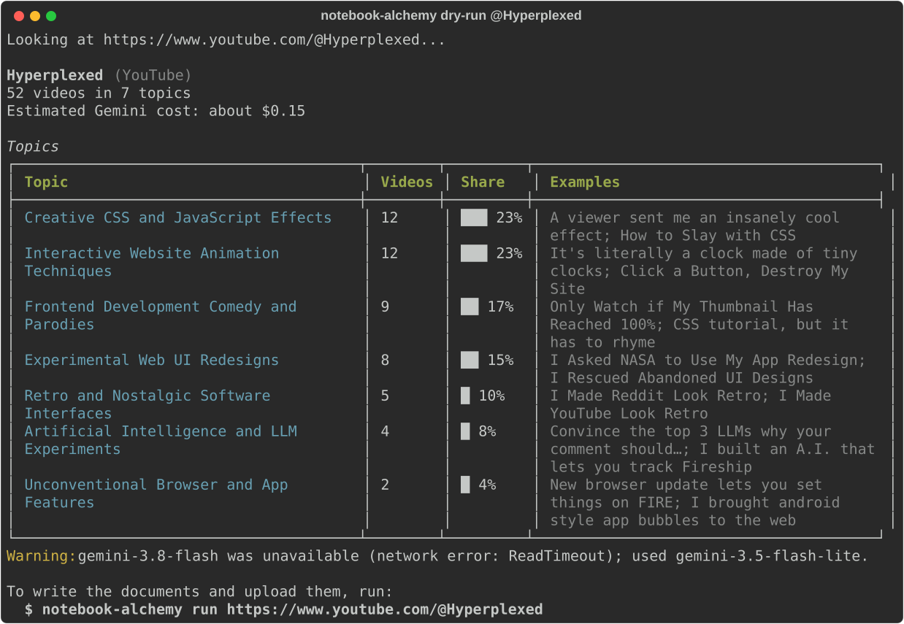

# ⚗ Notebook Alchemy — YouTube channels, distilled for NotebookLM

> A NotebookLM notebook holds a few hundred sources at most and a channel holds hundreds of videos. Read every word, keep each point once, file it by topic, and the whole channel fits.

<br>

<div align="center">


-4285F4?style=for-the-badge&logo=googlegemini&logoColor=white)


**Maintainer:** [gagexhill](https://github.com/gagexhill) — open source, MIT licensed, unofficial and not affiliated with Google
**Runtime:** A Python command-line tool and desktop MCP server (`stdio` + loopback `streamable-http`) on your machine; Claude, Gemini (`--watch`) and Google NotebookLM only when you opt in
**Status:** Alpha (`v0.4.0`) — see [open issues](https://github.com/gagexhill/notebook-alchemy/issues) for current roadmap work

<br>

🧭 **[Operations](OPERATIONS.md)** &nbsp;|&nbsp; 📋 **[Issues](https://github.com/gagexhill/notebook-alchemy/issues)** &nbsp;|&nbsp; 🤝 **[Contributing](CONTRIBUTING.md)**

</div>

---

## 📌 Table of Contents

- [Project Overview](#-project-overview)
- [The Problem It Solves](#-the-problem-it-solves)
- [Core Concept: Every Word, Kept Once, Filed by Topic](#-core-concept-every-word-kept-once-filed-by-topic)
- [Run Modes](#-run-modes)
- [Tech Stack](#-tech-stack)
- [Project Architecture](#-project-architecture)
- [Key Features](#-key-features)
- [How It Works — Under the Hood](#-how-it-works--under-the-hood)
- [Getting Started](#-getting-started)
- [File Structure](#-file-structure)
- [Concepts & References](#-concepts--references)
- [About the Owner](#-about-the-owner)

---

## 🌐 Project Overview

**Notebook Alchemy** takes a YouTube channel, playlist or video link, reads what every video says, keeps each point once, and uploads the result to a Google NotebookLM notebook as a few topic books. Each book can hold up to NotebookLM's 500,000 words per source. You can drive it from the command line or connect it via automatic local `stdio` MCP to **Claude Desktop**, **ChatGPT Desktop** (Codex / Work mode), and **Antigravity**.

The books hold the speakers' own words, never an AI rewrite (except optional `--watch N` transcriptions, which are explicitly marked):
- **Claude's job:** it decides which passages are worth keeping, files each one under a topic and section, puts each section in teaching order, and marks information that has gone out of date.
- **Each passage names its source:** the video it came from and the date, so NotebookLM's answers, quizzes and Audio Overviews cite something you can check.
- **Without a Claude API key:** the books hold every video's cleaned words, sorted by title.

Everything runs on your machine. The books go straight to NotebookLM; nothing is kept unless you ask for a copy with `--save`. The tool keeps no account data beyond what a feature needs (see [What It Stores](#what-it-stores)), sends nothing anywhere except YouTube, the Claude API and NotebookLM, and has no telemetry.

---

## 🔍 The Problem It Solves

A NotebookLM notebook accepts a limited number of sources: 50 on the free plan, 300 on Pro. A channel with hundreds of videos does not fit as one source per video. Importing only the first ones that fit leaves the rest of the channel out.

Even when the videos fit, each arrives as its own source, full of intros, sponsor reads and the same advice repeated across dozens of videos. Summaries are no better: NotebookLM answers from the text it is given, so a short summary leaves it little to answer from.

Notebook Alchemy changes the unit. Every video's words are read, repeated passages are kept once, and what remains is filed by subject into a few books. A channel of hundreds of videos becomes a handful of rich sources plus an overview.

---

## 🧬 Core Concept: Every Word, Kept Once, Filed by Topic

```text
channel ──► find ──► words ──► clean ──► label ──► sort ──► consolidate ──► books ──► NotebookLM
link       yt-dlp   captions,  filler,   Claude,   topics,  order, dupes,    plain     temp file,
           + dates  yt-dlp,    repeats   cached    sections, out-of-date     Markdown  replace by title
                    NotebookLM removed   per video cached    cached
```

1. **Find.** `yt-dlp` reads every video's id, title, duration and date from the channel's listings; no video is downloaded.
2. **Words.** Each video's text comes from the first of these routes that works:
   - your own `.txt`, `.vtt` or `.srt` files, then the local cache;
   - YouTube's captions, spaced a few seconds apart;
   - yt-dlp's subtitle download;
   - NotebookLM, which fetches a video's transcript on Google's side and is not affected when YouTube refuses your connection.

   A refused route pauses while the others carry on. A video still missing is listed in the overview and retried on the next run.
3. **Clean.** On your machine, free: caption noise and filler go, short calls to action and sponsor sentences go, and a passage repeated across videos (or within one) is kept once, in the newest video.
4. **Label.** One Claude request per video reads its numbered chunks and returns labels only: keep or drop, a headline, how long the information stays true, and an editor's note where a passage needs context. Captions without punctuation also come back punctuated; the punctuation is copied onto the original words, and no word is added or lost. Labels are cached per video.
5. **Sort.**
   - One request names the notebook and its topics and sections.
   - Every passage is placed by number; one the model does not place goes to a visible Miscellaneous book.
   - When new videos bring passages that fit nowhere, the map grows: new sections or topics are added, and nothing already placed moves. A section past 200 passages is divided into named subsections.
   - One request per section orders it, finds duplicates and finds passages a newer one replaces.
   - Old news is left out; old rules and figures are kept, marked "As of".
6. **Books and upload.** One plain-Markdown book per topic (split into parts only past 450,000 words; a section stays in its part from run to run), plus an `_OVERVIEW`. Each goes to NotebookLM as a file. The tool waits for processing, corrects any title NotebookLM changes, replaces earlier copies of books whose text changed (the rest are left as they are), removes books the last run made that this one no longer has, and reads the notebook back. A rerun updates the same notebook.

---

## 🎛 Run Modes

| Mode | Command | Calls out to | Writes | Use it when |
|---|---|---|---|---|
| Guided first run | `notebook-alchemy` | YouTube, NotebookLM, Claude if you add a key | One notebook | You want to be asked for each choice instead of reading options |
| Preview | `notebook-alchemy dry-run <url>` | YouTube | Nothing | You want the video count, the words already read and the cost first (`--now` prices standard calls) |
| Build and upload | `notebook-alchemy run <url>` | YouTube, NotebookLM, Claude if a key is set | One notebook | You want the books in NotebookLM |
| Keep a copy | `notebook-alchemy run <url> --save books` | YouTube, NotebookLM for blocked captions, Claude | `books/` | You want the books as files instead of uploading |
| Sooner, at full price | `notebook-alchemy run <url> --now` | YouTube, NotebookLM, Claude | One notebook | You want labels in seconds instead of a half-price batch, which usually takes under an hour (at most 24) |
| Without AI | `notebook-alchemy run <url> --offline` | YouTube, NotebookLM | One notebook | You want every word, sorted by title, at no API cost |
| Try it | `notebook-alchemy run --mock --save books` | Nothing | `books/` | You want to see the output before pointing it at a channel |
| Self-test | `notebook-alchemy test` | Nothing | A temporary folder | You want to check that everything installed correctly |
| Keep a sign-in fresh (optional) | `notebook-alchemy keep-signed-in` (`--off` to stop) | NotebookLM, every 20 minutes | A scheduled task for your user | Your computer keeps a refreshed sign-in alive (`status` shows whether it does) |
| Watch blocked videos | `notebook-alchemy run <url> --watch 5` | YouTube, NotebookLM, Claude, Gemini (`gemini-4-hydrogen`) | One notebook | Captions are unavailable for a few videos and you want opt-in Gemini transcription (marked in `_OVERVIEW.md`) |
| Desktop LLM connector | `notebook-alchemy mcp install all` | Local `stdio` (automatic per chat) | Client MCP config | You want Claude Desktop, ChatGPT Desktop (Codex / Work mode), or Antigravity to drive the pipeline directly |
| Move computers | `notebook-alchemy export-state FILE`, then `import-state FILE` | Nothing | A zip, then `~/.notebook-alchemy/` | You want to carry on from another computer without paying again |
| Set up | `notebook-alchemy setup` | `notebooklm` login, only if you sign in | `~/.notebook-alchemy/.env` | You want to save your Claude/Gemini keys or upload profile once for CLI and MCP clients |

Run `run` again whenever the channel posts. Only new videos cost anything, new passages join the sections they belong to, and only the books that changed are uploaded again.

---

## 🛠 Tech Stack

| Technology | Version | Role |
|---|---|---|
| Python | >=3.11 | Runtime |
| Click & Rich | >=8.1 / >=13.0 | Command-line parsing, prompts, progress bars, tables |
| anthropic | >=2.8, <3 | Official Claude SDK: structured answers, batches, retries (`claude-haiku-5-5`) |
| google-genai | >=3.2.0, <4 | Official Google GenAI SDK (`gemini-4-hydrogen` via Interactions API for opt-in `--watch`) |
| mcp | >=2.0, <3 | Official MCP Python SDK: dual-transport (`stdio` + `streamable-http`) connector |
| yt-dlp[default] | >=2026.10.21 | Channel listings with dates, and subtitles; `[default]` adds the JavaScript solver YouTube requires |
| youtube-transcript-api | >=1.2.4, <2 | Captions when no local transcript exists |
| notebooklm-py | >=0.8.6, <0.9 | Its Python API for notebooks, uploads and reading transcripts on Google's side; its `notebooklm` command for the sign-in window |
| pytest, ruff, pip-audit | dev extras | Tests, lint and format, dependency audit |

Versions are the ranges declared in `pyproject.toml`; the upper bounds keep out a next major release until it is tested. Override models with `ALCHEMY_MODEL` or `ALCHEMY_GEMINI_MODEL`; another Claude model must accept thinking turned off at low effort, as Claude Haiku 5.5 does.

---

## 🏗 Project Architecture

```text
src/notebook_alchemy/
├── cli.py          # Commands, options, prompts, exit codes (incl. `mcp serve|install|status`)
├── service.py      # Shared JSON-serializable service layer backing CLI and MCP tools
├── mcp_server.py   # Dual-transport MCP server (`stdio` + bearer-authenticated `streamable-http`)
├── mcp_install.py  # Atomic installers for Claude Desktop, Antigravity, ChatGPT Codex & HTTP guide
├── ui.py           # Steps, progress bars, warnings and errors, stderr routing for MCP stdio
├── engine.py       # The pipeline, the NotebookLM transcript route, slot-safe publish & --watch
├── channel.py      # YouTube scanning, dates, and every route to a video's words
├── watch.py        # Opt-in Gemini 4 Hydrogen video transcription via Interactions API (--watch)
├── cleanup.py      # Local cleanup, numbered chunks, passages repeated across videos
├── knowledge.py    # Claude labels per video, cached; a half-price batch with a standard-call fallback
├── library.py      # Passages, date rules, topics and sections, consolidation, request cache
├── writer.py       # The topic books and the overview (marks Gemini-transcribed videos)
├── offline.py      # The no-key path: every video's words, sorted by title words
├── state.py        # export-state / import-state: the working files, moved as a checked zip
├── keepalive.py    # keep-signed-in: the scheduled `notebooklm auth refresh`, per profile
├── claude.py       # Claude client: the official SDK, JSON-schema answers, batches, scrubbed errors, prices
├── client.py       # NotebookLM through notebooklm-py's Python API, with typed errors
├── config.py       # Environment and ~/.notebook-alchemy/.env + local .env settings
├── errors.py       # Typed errors that carry a next action
└── mock_data.py    # Synthetic sample catalog and transcripts, used only with --mock
```

`cli.py` and `mcp_server.py` both call `service.py` (or `AlchemyEngine` directly in `cli.py`), with `AlchemyEngine.build` orchestrating:
- `TranscriptManager` and optional `GeminiWatcher` (`--watch N`) to gather words;
- `cleanup` to chunk and dedupe them;
- `Labeler` (`claude.py`) to label them;
- `LibraryBuilder` to sort and consolidate;
- `render_library` to write the books.

`AlchemyEngine.publish` frees stale/owned unready sources first, replaces changed books in slot-safe waves, waits for processing, corrects NotebookLM-reset titles, and reads the notebook back before recording success. Every failure is an `AlchemyError`; CLI prints it via `ui.handle_errors`, and MCP tools return a scrubbed `ToolError`.

---

## ✨ Key Features

- **Every word, not a summary.** The books are the speakers' own words. Claude only labels, files and orders them, so nothing is invented or flattened into a summary.
- **Kept once.** A passage repeated across videos (stock intros, pitches, the same advice in thirty videos) appears once, in the newest video, and names every video that said it.
- **Dated.** Every passage carries its video's date. Old news is left out; old rules and figures are marked "As of 2023: check the current rules"; the overview lists what was left out.
- **Captions even when YouTube refuses.**
  - When YouTube blocks your connection, NotebookLM reads the transcripts instead.
  - Pass `--watch N` (with `GEMINI_API_KEY`) to transcribe up to `N` remaining blocked videos via Gemini 4 Hydrogen (`Interactions API`), clearly flagged in `_OVERVIEW.md`.
  - Requests are spaced so a long channel is not refused in the first place, and a refused route pauses without stopping the run.
- **Desktop LLM connector (MCP).** Drive previews, notebook lists, cleanups, and guarded builds from **Claude Desktop**, **ChatGPT Desktop** (Codex / Work mode), and **Antigravity** over automatic zero-port `stdio` (plus authenticated loopback `streamable-http` on `127.0.0.1` for local tooling).
- **Cheap to run again.**
  - Captions, labels, the topics, every passage's place and every section's order are cached by what produced them.
  - A rerun with no new videos asks the AI nothing and uploads nothing, unless a new year or a passage crossing a date rule changes a section's order.
  - New videos are placed into the existing topics; the map grows instead of being rebuilt, and only the books whose text changed are uploaded.
  - Labels are made in a half-price batch (`--now` for standard calls).
  - A used-up credit balance, spend limit or rate limit stops the run cleanly; the next run carries on.
- **Nothing kept that you did not ask for.** The books go to NotebookLM and are not stored; `--save DIR` writes a copy.
- **Knows your plan's limit.** `run` reads the upload account's NotebookLM plan (for example Pro: 300 sources per notebook) and will not upload past it. When the notebook is tight, the copies being replaced are removed first.
- **A known upload account.** `status` and `run` name the Google account that receives uploads, or say plainly when it is unknown. The first upload to an account asks first (`--yes` skips the question).
- **Checked uploads.** Each book is uploaded, waited on, titled and read back; failures are listed by book and the exit code is non-zero (see [Exit codes](#exit-codes)).
- **Key hygiene.** The Claude API key travels in a header only and is removed from every error and log line.
- **Plain output, detail on request.** Modelled on Google's `gcloud`:
  - everyday words and one line per result;
  - names in `[brackets]`;
  - `Warning:` and `Error:` on stderr, with a next step written as a command;
  - paths, token counts and models behind `-v`.
- **Hermetic tests.** The suite runs in a temporary working directory and home, with real processes and sockets blocked.

---

## ⚙ How It Works — Under the Hood

### Labels by number, never rewritten text

Claude answers with chunk numbers, in JSON that must match a schema (structured outputs), so every answer parses. A segment that points outside the video's chunks, or overlaps one already taken, is dropped and counted; a kept chunk no segment covers is kept anyway.

```python
span = {n for n in range(start, end + 1) if n in numbers}
if start > end or not span or span & taken:
    invalid += 1
    continue
taken |= span
```

### Punctuation without changing a word

For captions with no punctuation, the label answer also carries the kept words punctuated. Its punctuation and capitals are copied onto the original words wherever the two line up; a word the model dropped keeps its original form, and a word it added is never used.

```python
for tag, i1, i2, j1, _j2 in matcher.get_opcodes():
    if tag == "equal":
        for k in range(i2 - i1):
            out[i1 + k] = pun[j1 + k]  # same word, with the model's punctuation and capitals
```

### Keeping the API key out of everything

The official SDK sends the key in a request header, never the URL, and only to the Claude API's own address, which is fixed in the code; `.env` is read only for this tool's own settings. Every message passes through `scrub` before it is raised or logged.

```python
cleaned = text.replace(api_key, "***") if api_key else text
return _KEY_SHAPE.sub("sk-ant-***", cleaned)
```

### Uploading as a file

NotebookLM receives each book as a file. A book can be far larger than one command-line argument can carry on Windows, so the content never travels there.

```python
with tempfile.TemporaryDirectory(prefix="notebook-alchemy-", ignore_cleanup_errors=True) as tmp:
    path = Path(tmp) / f"{safe[:80]}.md"
    path.write_text(document.content, encoding="utf-8")
```

---

## 🚀 Getting Started

### Install

One command installs everything: [uv](https://docs.astral.sh/uv/) (if it is missing), Notebook Alchemy, and the Chromium browser it uses for Google sign-in. It then adds a **Notebook Alchemy** shortcut and runs the self-test. It asks for no password or key, and writes only inside your home folder.

Windows (PowerShell):

```powershell
irm https://raw.githubusercontent.com/gagexhill/notebook-alchemy/main/install/install.ps1 | iex
```

macOS and Linux:

```bash
curl -LsSf https://raw.githubusercontent.com/gagexhill/notebook-alchemy/main/install/install.sh | sh
```

The shortcut is on the desktop on Windows and macOS, and in the applications menu (and on the desktop, if there is one) on Linux. It opens a terminal in the `Notebook Alchemy` folder in your home folder, where your settings and output are kept, and starts `notebook-alchemy`, which walks you through signing in to NotebookLM, an optional Claude API key and your first channel. Run the same command again to update to the newest version. Run it as your own user, not with `sudo`. To read a script before running it, open [`install/install.ps1`](install/install.ps1) or [`install/install.sh`](install/install.sh).

To remove it, delete the shortcut and the folder that holds its icon (`%LOCALAPPDATA%\notebook-alchemy` on Windows, `~/Library/Application Support/notebook-alchemy` on macOS, `~/.local/share/notebook-alchemy` on Linux; on Linux also delete `~/.local/share/applications/notebook-alchemy.desktop`), then run:

```bash
uv tool uninstall notebook-alchemy
```

The `Notebook Alchemy` folder keeps your settings and output until you delete it. Chromium stays in Playwright's `ms-playwright` folder (in your local app data on Windows, `~/Library/Caches` on macOS, `~/.cache` on Linux), where other tools may share it.

To work on the code, install from source as below instead.

### Prerequisites

- Python 3.11 or newer
- A Google account with NotebookLM. It is also how blocked videos' transcripts are read.
- A [Claude API key](https://platform.claude.com/settings/keys), only if you want AI sorting (the API is paid; see Cost below)

### Installation

```bash
git clone https://github.com/gagexhill/notebook-alchemy.git
cd notebook-alchemy
python -m pip install -e .
notebook-alchemy test
```

`notebook-alchemy test` builds the sample catalog in a temporary folder and needs no network or credentials. Use `python3` on macOS and Linux if `python` is not Python 3, and run any command as `python -m notebook_alchemy.cli …` if `notebook-alchemy` is not on your `PATH`.

### Set up and run

The quickest start is the guided run: type `notebook-alchemy` with nothing after it. It signs you in to NotebookLM (a browser window), offers to add a Claude API key for topic sorting, asks for a channel link, and builds the notebook. Every question has a default, so Enter is enough.

```bash
notebook-alchemy
```

For more control, the separate commands below do the same steps one at a time.

The guided setup asks for the Claude API key (hidden as you type), optional Gemini API key (`--watch`), and Google account to upload to, and writes them to `~/.notebook-alchemy/.env` (shared across CLI runs and Desktop MCP clients; pass `--local` to write `./.env` instead). Run it again whenever you want to change any of them:

```bash
notebook-alchemy setup
notebook-alchemy status
```

The Claude API key and the NotebookLM account are separate credentials:
- **The key** bills to the Claude Console workspace it was made in. Make a workspace for this tool with a monthly spend limit, so the key can reach nothing else and cost little.
- **Uploads** go to whichever Google account the `notebooklm` profile is signed in to; `status` names it.
- **A Claude subscription** (Pro, Max) does not cover API use: the API is billed separately, in the Console.

Sign-in is through a browser window. To keep an account in its own profile, and have the sign-in fail if a different account was used, name both:

```bash
notebook-alchemy login
notebook-alchemy login --account you@example.test --profile personal
```

The window needs a browser for Playwright, installed once with `python -m playwright install chromium` (the one-line installer does this). Notebook Alchemy never reads an installed browser's saved sign-ins.

Google ends a sign-in that sits idle for a few hours. When yours has ended, `run` and the guided run say so, ask you to sign in again (one browser window), and carry on; the work already done is kept. A long run checks again before it uploads. Outside a terminal, the run stops with the sign-in command instead.

`notebook-alchemy keep-signed-in` is optional: it refreshes the sign-in every 20 minutes in the background (a Task Scheduler task on Windows, a launchd agent on macOS, a systemd user timer or cron on Linux). It keeps a sign-in alive only while Google accepts the refresh, and on some computers Google still ends it within hours; `status` shows when it last worked. `keep-signed-in --off` removes it. Notebook Alchemy never stores a long-lived Google token for you.

Then preview and build:

```bash
notebook-alchemy dry-run https://www.youtube.com/@Hyperplexed
notebook-alchemy run https://www.youtube.com/@Hyperplexed
```

A real preview of that channel, recorded from the terminal:



**Cost**
- **Per video:** one labelling request. The label answer is a few percent of the transcript; it is larger only for captions that need punctuation. With Claude Haiku 5.5 that is a fraction of a cent per video.
- **Estimate first:** `dry-run` estimates the cost from the words already read and from video lengths.
- **Half price:** labels are made in a batch, which costs half and usually finishes within an hour (at most 24 hours); a run still waiting says so, and the same command collects it. `--now` uses standard calls instead.
- **Limits:** when the account's credit, its spend limit or a rate limit stops a request, the run stops with what it has kept, and the next run carries on.

**Captions**
- **Language:** captions are read in English first. Set `ALCHEMY_CAPTION_LANGUAGES` (for example `de,en`) for other languages.
- **When YouTube refuses:** NotebookLM reads the transcripts in a working notebook called "Notebook Alchemy workspace" in your upload account. Each video is added there, read and removed.
- **Browser sign-in for yt-dlp:** `--cookies chrome` lets yt-dlp use your browser's YouTube sign-in. On Windows, Chrome and Edge often lock or encrypt it, and the run says so.

**Channel tabs:** a channel link reads the Videos and Live tabs; add Shorts with `--tabs videos,streams,shorts`. Playlist and video links are read as they are.

### Connect to Desktop LLMs (MCP)

Notebook Alchemy includes an [MCP](https://modelcontextprotocol.io) server exposing five tools (`alchemy_status`, `alchemy_preview`, `alchemy_run`, `alchemy_notebooks`, `alchemy_clean`), two read-only resources (`alchemy://status`, `alchemy://notebooks`), and the `distill_youtube_channel` prompt.

Register it in **Claude Desktop**, **Antigravity**, and **ChatGPT Desktop (Codex / Work mode)** with one command (merges cleanly into each client's config file; preview with `--dry-run`). Each app launches and stops local `stdio` automatically with zero open network ports or tunnels:

```bash
notebook-alchemy mcp install all --dry-run
notebook-alchemy mcp install all
notebook-alchemy mcp status
```

Or install one client at a time:
- **Claude Desktop** (`claude_desktop_config.json`, auto-detecting Windows Store/MSIX `LocalCache` or `%APPDATA%\Claude`): `notebook-alchemy mcp install claude-desktop`
- **Antigravity** (`~/.gemini/config/mcp_config.json`): `notebook-alchemy mcp install antigravity`
- **ChatGPT Desktop / Codex CLI** (`~/.codex/config.toml`): `notebook-alchemy mcp install chatgpt-codex`

**Local HTTP debugging (`streamable-http`):** For local inspectors on the same machine, HTTP binds strictly to `127.0.0.1` with DNS-rebinding protection and requires `ALCHEMY_MCP_TOKEN` (or `--token`):

```bash
# Put ALCHEMY_MCP_TOKEN=<long-random-secret> in ~/.notebook-alchemy/.env
notebook-alchemy mcp serve --transport streamable-http --port 8765
```

**Shared MCP safety rules:**
- `mcp serve` routes Rich/status output strictly to `stderr` so JSON-RPC on `stdout` stays clean.
- `alchemy_preview` and `alchemy_run` accept only YouTube URLs / `@handles` (unless `mock=True`), and never overwrite first-time NotebookLM accounts silently (`confirm_upload=True` is required for first-time uploads, and `confirm=True` for destructive cleans).
- Any Claude/Gemini API key or `ALCHEMY_MCP_TOKEN` is scrubbed from MCP errors before reaching the client.

### Exit codes

| Code | Meaning |
|---|---|
| 0 | Done. |
| 1 | A failure the message explains, with a next step: a channel that cannot be read, an ended sign-in outside a terminal, a failed upload, a failed self-test. |
| 2 | A wrong option or argument, or a setting in `.env` or the environment that is not valid. |
| 70 | An unexpected error; run again with `--debug` and report it. |
| 130 | Stopped with Ctrl+C. |

### What It Stores

Everything stays on your machine. `notebook-alchemy clean --all` removes the working files and asks first; the last two rows are removed as shown.

| Where | What | Removed by |
|---|---|---|
| `~/.notebook-alchemy/.env` (or `./.env` with `--local`) | Your Claude/Gemini API keys, profile, and optional `ALCHEMY_MCP_TOKEN`, written by `setup` | Delete the file |
| `~/.notebook-alchemy/cache/` | Downloaded words per video, and which videos had none (for a week) | `clean --cache` |
| `~/.notebook-alchemy/knowledge/`, `library/`, `batches/` | The AI's labels, topics, placements and section orders, so reruns cost nothing, and per channel a labelling batch still running and its answers until they are stored | `clean --labels` |
| `~/.notebook-alchemy/sync/`, `notebooks.json`, `upload_accounts.json` | What the last upload added, which notebook each channel uses, and a salted hash of the account you confirmed uploads to (not the email) | `clean --records` |
| `~/.notebooklm/profiles/<profile>/` | The Google sign-in, kept by notebooklm-py | `notebooklm auth logout` |
| Your system scheduler, and `~/.notebook-alchemy/keepalive.json` | The 20-minute sign-in refresh (only if you turned it on) and when it last ran | `keep-signed-in --off` (asks first in a terminal; `--yes` skips); `clean --records` |
| Your NotebookLM account | The notebook itself, and the "Notebook Alchemy workspace" notebook used to read blocked videos (left empty after each run) | Delete them in NotebookLM |

`notebook-alchemy export-state FILE` copies the cache, `knowledge/`, `library/`, `sync/` and `notebooks.json` into one zip; `import-state FILE` on another computer carries on from there, keeping files that computer already has (`--replace` overwrites them, asking first in a terminal). Sign-ins, the key, the upload confirmation and a labelling batch still running are not included.

Version 0.2 wrote a `vault/` folder; `clean --vaults` removes it.

### Build for Production

The package builds a wheel with Hatch:

```bash
python -m pip install build
python -m build
```

> **Notes.** `dry-run` shows an estimated cost; the estimate comes from transcript length and the price table in `src/notebook_alchemy/claude.py`, so check Anthropic's pricing page before a large run. `clean` deletes only this tool's own files. It asks before deleting labels or records, and in a terminal before deleting captions; `--yes` skips the question.

For contributors: [CONTRIBUTING.md](CONTRIBUTING.md) to propose a change, [AGENTS.md](AGENTS.md) for the rules every change keeps, [OPERATIONS.md](OPERATIONS.md) for the maintainer runbook, [DEVLOG.md](DEVLOG.md) for past design decisions, and [the issues](https://github.com/gagexhill/notebook-alchemy/issues) for current work.

---

## 📁 File Structure

```text
notebook-alchemy/
├── src/notebook_alchemy/   # The tool (see Project Architecture)
├── tests/                  # Hermetic pytest suite; conftest.py isolates every test
├── .github/                # Issue and PR templates, Dependabot, validate workflow
├── .githooks/              # pre-push secret scan (gitleaks)
├── install/                # One-line installers: install.ps1 (Windows), install.sh (macOS, Linux)
├── scripts/                # Regenerate the recordings, preview and icons; check the NotebookLM library
├── docs/images/            # README recordings and the social preview image
├── docs/brand/             # icon.svg, the generated favicons and app icons, and the concept sheet
├── AGENTS.md               # Rules every change keeps
├── DEVLOG.md               # Past design decisions and why
├── OPERATIONS.md           # Maintainer runbook
├── SECURITY.md             # Credential handling and private reporting
├── CONTRIBUTING.md         # Setup, checks, pull requests
├── pyproject.toml          # Package, dependencies, ruff and pytest settings
├── .env.example            # Environment variables, placeholders only
└── LICENSE                 # MIT
```

---

## 📚 Concepts & References

| Concept | Applied In |
|---|---|
| Flat metadata extraction with approximate dates | `src/notebook_alchemy/channel.py` (`ChannelScanner.scan`) |
| Per-route pauses and paced requests | `src/notebook_alchemy/channel.py` (`TranscriptManager`) |
| Reading transcripts on Google's side | `src/notebook_alchemy/engine.py` (`transcripts_via_notebooklm`) |
| Shingle-based duplicate removal, newest copy kept | `src/notebook_alchemy/cleanup.py` (`mark_duplicates`) |
| Labels by number instead of generated text | `src/notebook_alchemy/knowledge.py` (`parse_labels`) |
| Content-keyed caching of every paid answer | `src/notebook_alchemy/knowledge.py` (`label_key`), `src/notebook_alchemy/library.py` (`RequestCache`) |
| Half-price batches with a standard-call fallback | `src/notebook_alchemy/knowledge.py` (`Labeler`), `src/notebook_alchemy/claude.py` (`submit_batch`) |
| Date rules for time-sensitive information | `src/notebook_alchemy/library.py` (`apply_date_rules`) |
| Read-back verification after an upload | `src/notebook_alchemy/engine.py` (`publish`) |
| Identity read from the credential's own record, never guessed | `src/notebook_alchemy/client.py` (`upload_account`) |
| Answers that must match a JSON schema (structured outputs) | `src/notebook_alchemy/claude.py` (`request_params`), `src/notebook_alchemy/knowledge.py` (`label_schema`) |
| Header-based API authentication and secret scrubbing | `src/notebook_alchemy/claude.py` (`scrub`), `src/notebook_alchemy/watch.py` (`scrub`) |
| Google GenAI Interactions API for video watch fallback | `src/notebook_alchemy/watch.py` (`GeminiWatcher.watch_video`) |
| Dual-transport MCP server (`stdio` + bearer-protected `streamable-http`) | `src/notebook_alchemy/mcp_server.py` (`build_mcp_server`), `src/notebook_alchemy/service.py` |
| Typed errors that carry a next action | `src/notebook_alchemy/errors.py`, `src/notebook_alchemy/ui.py` |
| Hermetic tests with blocked processes and sockets | `tests/conftest.py` |

---

## 👤 About the Owner

Built and maintained by **Gage Hill** ([`@gagexhill`](https://github.com/gagexhill)) as a personal open-source project under the MIT License. Issues and pull requests are welcome at [gagexhill/notebook-alchemy](https://github.com/gagexhill/notebook-alchemy).

---

<div align="center">

**Notebook Alchemy** — *a channel in, a notebook out.*

© 2026 gagexhill and contributors · MIT License

</div>
