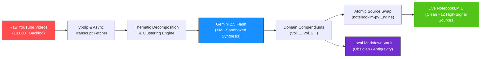

<div align="center">

# ⚡ Notebook Alchemy

### *Bypass Google NotebookLM’s 300-source limit. Autonomously distill 10,000+ YouTube videos into self-organizing, human-readable Domain Compendiums.*

[](https://github.com/gagexhill/notebook-alchemy/actions/workflows/ci.yml)
[](SECURITY.md)
[](https://www.python.org/downloads/)
[](LICENSE)
[](https://modelcontextprotocol.io/)
[](https://github.com/gagexhill/notebook-alchemy)

[Quickstart](#-3-command-quickstart) • [Architecture](#-architecture) • [Before vs After](#-before-vs-after-the-300-source-wall) • [AI Studio Key Guide](#-step-by-step-gemini-api-key--google-ai-studio-guide) • [Contributing](CONTRIBUTING.md)

</div>

---

## 🧱 The Problem: "The 300-Source Wall"

Google NotebookLM is arguably the most powerful grounded RAG and audio-synthesis interface ever built. However, power users, researchers, and solo operators quickly slam directly into **The 300-Source Wall**:

1. **Hard 300-Source Cap**: A single notebook hard-stops at 300 sources. Ingesting an active YouTube channel, podcast backlog, or federal contract archive is structurally impossible.
2. **Context Dilution**: Even with 250+ raw transcripts, query quality degrades into fragmented answers and incomplete citations.
3. **No Native Topic Synthesis**: NotebookLM treats every uploaded link as a flat, unorganized leaf node. You end up with 300 chaotic titles and zero hierarchical clarity.

---

## 🔮 The Solution: Information Alchemy

**Notebook Alchemy** acts as an autonomous synthesis engine that sits between high-volume source libraries and NotebookLM. It executes **Thematic Decomposition**:

- Transcribes and chunks raw video libraries (via `yt-dlp` and async transcript engines).
- Employs **Gemini 2.5 Flash** with structured XML-sandboxed prompts to cluster, cross-reference, and synthesize related sources into structured **Domain Compendiums**.
- Executes an **Atomic Swap** into your live NotebookLM workspace, replacing hundreds of raw, disjointed videos with 10–15 curated, high-density reference compendiums.
- Bridges your synthesized notes into local markdown vaults (Obsidian, Logseq, Antigravity) with bi-directional links.

---

## 📊 Before vs. After: "The 300-Source Wall"

| Dimension | Before: Raw YouTube Links | After: Notebook Alchemy Compendiums |
| :--- | :--- | :--- |
| **Source Footprint** | 288 flat video URLs (approaching the 300 limit) | **12 Structured Domain Compendiums** |
| **Organization** | Unorganized, chronological timeline | **Topic-Clustered** (e.g. `GBP Ranking & Optimization (Vol. 1)`) |
| **Citation Depth** | Shallow single-video quotes | **Cross-Video Synthesis** with consolidated citations |
| **Quota Headroom** | 12 sources remaining before failure | **288 free slots** available for new research |
| **Studio Artifacts** | Audio Overviews hallucinate across clutter | **Crystal-clear Deep Dives** focused on coherent themes |

---

## 🏗️ Architecture



---

## 🚀 3-Command Quickstart

Get up and running in under 60 seconds using `pip` or `uvx`:

```bash
# 1. Clone repository
git clone https://github.com/gagexhill/notebook-alchemy.git
cd notebook-alchemy

# 2. Install editable engine
pip install -e .

# 3. Inspect your notebook safely (Zero API cost pre-flight)
notebook-alchemy dry-run -n "Portable Entrepreneur"
```

---

## 🔑 Step-by-Step Gemini API Key & Google AI Studio Guide

Notebook Alchemy uses Google Gemini Flash for high-speed, cost-effective transcript synthesis (averaging **<$0.20 total** for hundreds of videos).

### 1. Generate Your Key in Google AI Studio
1. Navigate to **[aistudio.google.com/app/apikey](https://aistudio.google.com/app/apikey)**.
2. Sign in with your Google account.
3. Click **"Create API key"** and select or create a project.
4. Copy your key (starts with `AIzaSy...`).

### 2. Configure Your Local `.env`
Notebook Alchemy uses a strict zero-leak security architecture. Your `.env` file is permanently blocked by `.gitignore`.

1. Copy the example configuration:
   ```bash
   cp .env.example .env
   ```
2. Open `.env` and paste your key:
   ```env
   GEMINI_API_KEY=AIzaSyYourGeneratedKeyHere
   ```

### 3. Authenticate with NotebookLM
Run the browser login to establish your persistent local session:
```bash
notebooklm login
```
*Your browser will launch, detect your active Google AI Pro session, and write authentication state safely to your local user directory.*

---

## 🧪 Pre-Flight Dry-Run Preview

Run a non-destructive simulation before touching live NotebookLM workspaces:

```bash
notebook-alchemy dry-run -n "Portable Entrepreneur"
```

```text
╭─────────────────────────── Dry-Run Cost & Token Sizing ───────────────────────────╮
│ Notebook: Portable Entrepreneur (6fd9a6b5-5065-4c0f-ba7e-711c712fc3c9)             │
│ Total Sources: 288                                                                 │
│ YouTube Video Sources: 288                                                         │
│ Other Documents/Notes: 0                                                           │
│                                                                                    │
│ Total Estimated Tokens: ~1,296,000                                                 │
│ Estimated Gemini Flash Input Cost: $0.0972 USD                                     │
│ Estimated Synthesis Output Cost: $0.0432 USD                                       │
│ Total Estimated Cost: $0.1404 USD                                                  │
╰────────────────────────────────────────────────────────────────────────────────────╯
```

---

## 🛡️ Security & Zero-Leak Architecture

- **Strict Sandbox**: Session cookies and storage states (`storage_state.json`) are stored strictly in local user profiles and blocked by `.gitignore`.
- **Gitleaks Audited**: Every push and PR is scanned for accidentally exposed secrets.
- **Dry-Run Default**: The engine never deletes or mutates existing sources without explicit user confirmation.

---

## 🗺️ Public Roadmap

- [x] Initial scaffold & Playwright browser session engine (`v0.1.0`)
- [x] Pre-flight dry-run token estimation & topic clustering (`v0.1.1`)
- [ ] **v1.1**: Native Podcast / RSS Feed & Local PDF Folder Ingestion ([#1](https://github.com/gagexhill/notebook-alchemy/issues/1))
- [ ] **v1.2**: Interactive Streamlit / Gradio Local Web Dashboard ([#2](https://github.com/gagexhill/notebook-alchemy/issues/2))
- [ ] **v1.3**: Domain Preset Lenses (Academic Research, Legal Discovery, Solo Agency) ([#3](https://github.com/gagexhill/notebook-alchemy/issues/3))
- [ ] **v1.4**: Async parallel transcript batching with proxy rotation ([#4](https://github.com/gagexhill/notebook-alchemy/issues/4))

---

## 🤝 Community & Contributing

We welcome pull requests and feature proposals from the developer community!
- Read our [Contributing Guide](CONTRIBUTING.md) to set up your dev environment.
- Review our [Code of Conduct](CODE_OF_CONDUCT.md).
- Open or join discussions on our [GitHub Discussions](https://github.com/gagexhill/notebook-alchemy/discussions) board.

---

## 📜 License

This project is licensed under the terms of the [MIT License](LICENSE).
