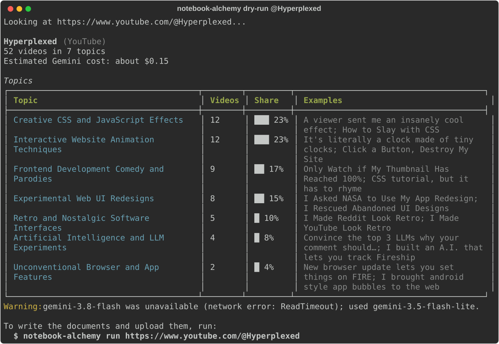
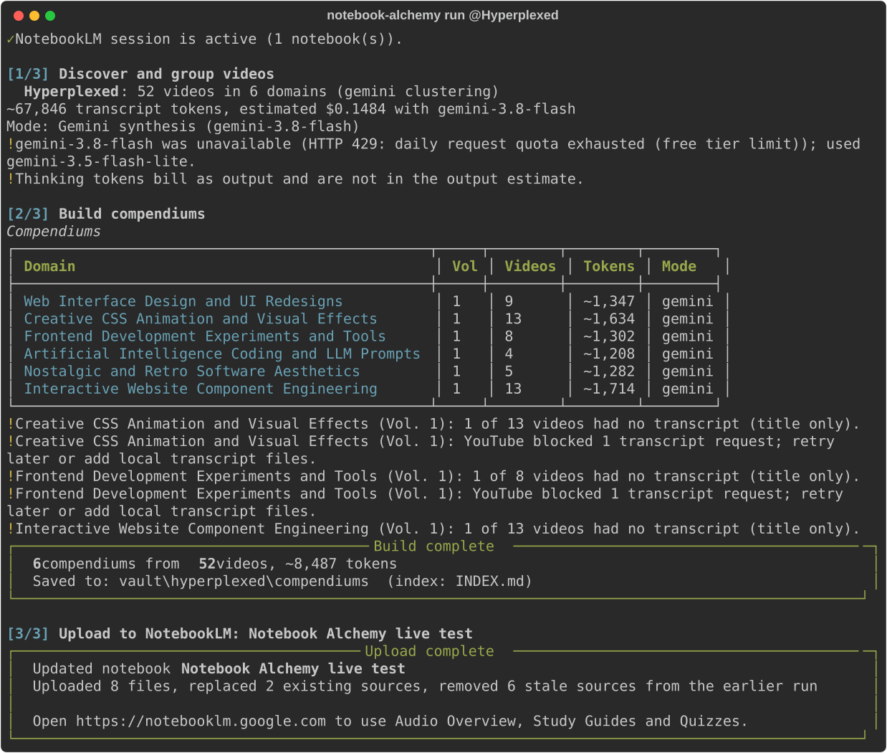

# ⚗ Notebook Alchemy — YouTube channels, distilled for NotebookLM

> A NotebookLM notebook holds a few dozen sources and a channel holds hundreds of videos. Group the videos by subject, write one document per subject, and the archive fits.

<br>

<div align="center">


**Owner:** Gage Hill — personal open-source project
**Runtime:** A Python command-line tool on your machine; the Gemini API and Google NotebookLM only when you opt in
**Status:** Alpha — [audit remediation #16](https://github.com/gagexhill/notebook-alchemy/issues/16) owns current progress

<br>

🧭 **[Operations](OPERATIONS.md)** &nbsp;|&nbsp; 📋 **[Issues](https://github.com/gagexhill/notebook-alchemy/issues)** &nbsp;|&nbsp; 🤝 **[Contributing](CONTRIBUTING.md)**

</div>

---

## 📌 Table of Contents

- [Project Overview](#-project-overview)
- [The Problem It Solves](#-the-problem-it-solves)
- [Core Concept: Distill by Domain](#-core-concept-distill-by-domain)
- [Run Modes](#-run-modes)
- [Tech Stack](#-tech-stack)
- [Project Architecture](#-project-architecture)
- [Key Features](#-key-features)
- [How It Works — Under the Hood](#-how-it-works--under-the-hood)
- [Getting Started](#-getting-started)
- [File Structure](#-file-structure)
- [Concepts & References](#-concepts--references)
- [About the Owner](#-about-the-owner)

---

## 🌐 Project Overview

**Notebook Alchemy** reads a YouTube channel, playlist or video, groups its videos into subject domains, writes one Markdown compendium per domain, and uploads the set to a Google NotebookLM notebook.

The compendiums come in two forms. With a Gemini API key, each volume is synthesized from the spoken transcripts of its videos and cites them by number. Without one, each volume is an offline index of titles and links that says plainly it contains no summary. Nothing is ever filled in with invented text, and the bundled sample catalog is used only when you pass `--mock`.

This repository owns the command-line tool, its tests, and the operating records that go with it. Google owns the live state of NotebookLM and the Gemini API; `ventryn-cloud/STANDARDS.md` owns the standards this repository follows.

---

## 🔍 The Problem It Solves

A NotebookLM notebook accepts a limited number of sources, and the limit depends on your plan (Google's plan limits page lists it). A channel with hundreds of videos does not fit as one source per video, and importing only the first ones that fit leaves the rest of the channel out.

Even when the videos fit, each one arrives as its own source. A question about one subject has to draw on dozens of them, and there is no document that covers the subject as a whole.

Notebook Alchemy changes the unit. The videos are grouped by subject first, then written as one document per group, with a catalog of every source and an index. A 52-video channel becomes six or seven domain volumes plus an index and a catalog: eight or nine sources. The example under [Getting Started](#-getting-started) shows the real output.

---

## 🧬 Core Concept: Distill by Domain

```text
YouTube URL ──► discover ──► group ──► resolve transcripts ──► write volumes ──► vault ──► NotebookLM
              yt-dlp       Gemini or    local files, cache,    Gemini synthesis   _INDEX.md  file sources,
              metadata     keywords     captions API           or offline index   + catalog  replace by title
```

1. **Discover.** `yt-dlp` reads flat metadata (id, title, duration), so no video is downloaded.
2. **Group.** With a Gemini key, domains are discovered from a sample of titles and every title is then assigned by number; anything unassigned lands in a visible Miscellaneous domain. Without a key, a keyword table groups the titles.
3. **Resolve transcripts** (live mode). Each video's text comes from your own `.txt`, `.vtt` or `.srt` files, then the local cache, then YouTube captions, fetched with a bounded worker pool. Videos with no captions are remembered for a week.
4. **Write volumes.** A domain with more than `--max-per-vol` videos (50 by default) splits into volumes. Live volumes are synthesized by Gemini and end with a generated source table; offline volumes are indexes.
5. **Write the vault.** Everything is built in a staging folder and swapped into `vault/<source>/compendiums/` only when complete, together with `_INDEX.md` and `_MASTER_SOURCES_CATALOG.md`. The leading underscore keeps those two at the top of NotebookLM's source list (sorted by title) and of most file browsers.
6. **Upload.** Each file goes to NotebookLM as a file source. The tool waits for NotebookLM to process each one, corrects any title NotebookLM rewrites to the file name, replaces older copies with the same title, removes sources it uploaded last time that this build no longer has, and reads the notebook back to confirm each title appears once. Any file that fails is listed with its cause.

---

## 🎛 Run Modes

| Mode | Command | Calls out to | Writes | Use it when |
|---|---|---|---|---|
| Preview | `notebook-alchemy dry-run <url>` | YouTube; Gemini if a key is set | Nothing | You want video count, domains and estimated cost first |
| Build with Gemini | `notebook-alchemy run <url> --no-sync` | YouTube, Gemini, YouTube captions | `vault/` | You want synthesized volumes to read or edit before uploading |
| Build offline | `notebook-alchemy run <url> --no-sync --offline` | YouTube only | `vault/` | You want the index and catalog with no API cost |
| Build and upload | `notebook-alchemy run <url>` | The above plus NotebookLM | `vault/`, one notebook | You are ready to use the result in NotebookLM |
| Upload later | `notebook-alchemy sync -n <name>` | NotebookLM | One notebook | A build already exists in `vault/` |
| Add one video | `notebook-alchemy append -n <name> --title … --url …` | Nothing | The catalog and one volume | A new video appeared and a rebuild is not worth it |
| Try it | `notebook-alchemy run --mock --no-sync` | Nothing | `vault/` | You want to see the output before pointing it at a channel |
| Self-test | `notebook-alchemy test` | Nothing | A temporary folder | You want to check the install |

---

## 🛠 Tech Stack

| Technology | Version | Role |
|---|---|---|
| Python | >=3.10 | Runtime |
| Click | >=8.1.0 | Command-line parsing, prompts, help |
| Rich | >=13.0.0 | Tables, progress bars, error panels |
| httpx | >=0.25.0 | Gemini API calls |
| yt-dlp | >=2025.1.0 | Flat channel and playlist metadata |
| youtube-transcript-api | >=1.0.0 | Captions when no local transcript exists |
| notebooklm-py | >=0.8.6 | The `notebooklm` command used for login, notebooks and uploads |
| Gemini API | `gemini-3.8-flash` by default, `gemini-3.5-flash-lite` as fallback | Domain discovery, title assignment, synthesis |
| pytest, ruff, pip-audit | dev extras | Tests, lint and format, dependency audit |

Versions are the minimums declared in `pyproject.toml`. Override the model with `ALCHEMY_GEMINI_MODEL`.

---

## 🏗 Project Architecture

```text
src/notebook_alchemy/
├── cli.py          # Commands, options, prompts, exit codes
├── ui.py           # Steps, progress bars, error panels, markup-safe text
├── engine.py       # Orchestrates discovery, build, vault write, sync, append
├── analyzer.py     # Source discovery, domain clustering, token and cost estimates
├── channel.py      # YouTube scanning, URL handling, transcript resolution and cache
├── synthesizer.py  # Live Gemini volumes, offline indexes, index and catalog files
├── gemini.py       # Gemini client: header auth, retries, model fallback, scrubbed errors, price table
├── client.py       # NotebookLM through the `notebooklm` command, with checked results
├── vault.py        # Vault layout and the atomic directory swap
├── config.py       # Environment and .env settings
├── errors.py       # Typed errors that carry a next action
└── mock_data.py    # Synthetic sample catalog, used only with --mock
```

`cli.py` builds an `AlchemyEngine` from `AlchemyConfig` and passes `ui.Reporter` as a progress callback. The engine asks `NotebookAnalyzer` for a `DryRunReport` (videos, domains, cost), has `Synthesizer` build each volume, and hands the staging folder to `VaultManager`. Upload goes through `NotebookLMClient`. Every failure is an `AlchemyError`; `ui.handle_errors` prints its message and next step and sets the exit code.

---

## ✨ Key Features

- **Real input, real output** — a bad URL, an unknown notebook or a zero-video channel is an error with a next step. Sample data appears only behind `--mock`, with a banner.
- **Checked uploads** — files are uploaded one by one, each result is verified, failures are listed by file, and the exit code is non-zero.
- **Replace, not duplicate** — a re-run replaces same-titled sources and removes the ones it uploaded last time that are gone, so repeated runs do not pile up in the notebook. Sources you added yourself are never touched.
- **Survives a busy model** — if the default Gemini model is overloaded, retired, or out of daily quota, the run moves to the fallback model and says so.
- **Every title assigned** — clustering covers the whole channel, not a sample, and reports what it could not place.
- **Honest offline mode** — without a key you get an index and a catalog, labelled as such.
- **Safe writes** — output is namespaced per source, built in staging, and swapped in whole, so a failed run leaves the previous build intact.
- **Key hygiene** — the Gemini key travels in a header only and is removed from every error and log line.
- **Cost and quota before commitment** — `dry-run` estimates tokens from video length, prices them for the configured model, and prints how many Gemini requests a run needs.
- **Guided terminal output** — numbered steps, progress bars on a terminal, plain lines when piped, and `NO_COLOR` honoured.
- **Hermetic tests** — the suite runs in a temporary working directory and home, with real processes and sockets blocked.

---

## ⚙ How It Works — Under the Hood

### Swapping a build into place

The vault is replaced as a whole. The old folder is renamed aside, the staged one renamed in, and the old one restored if either step fails.

```python
try:
    if had_old:
        final.rename(backup)
    staged.rename(final)
except OSError as exc:
    if had_old and backup.exists() and not final.exists():
        backup.rename(final)
    raise VaultError(
        f"Could not write the vault directory {final}: {exc}",
        hint="Close programs that have files in it open (editors, sync tools) and retry.",
    ) from exc
```

### Keeping the API key out of everything

The key goes in a request header, never the URL, and every message passes through `scrub` before it is raised or logged.

```python
headers = {"x-goog-api-key": self._api_key, "content-type": "application/json"}
```

```python
def scrub(text: str, api_key: str) -> str:
    """Remove the API key (and any `key=...` query fragment) from text."""
    cleaned = _KEY_IN_TEXT.sub(r"\1***", text)
    if api_key:
        cleaned = cleaned.replace(api_key, "***")
    return cleaned
```

### Assigning every title by number

The model answers with title numbers, not title text, so a paraphrased title cannot drift. Anything outside the batch or the domain list is ignored and ends up in the Miscellaneous domain.

```python
for key, value in mapping.items():
    try:
        t_idx, d_idx = int(key), int(value)
    except (TypeError, ValueError):
        continue
    if start <= t_idx < start + len(batch) and 0 <= d_idx < len(domains):
        assigned[t_idx] = d_idx
```

### Uploading as a file

NotebookLM receives each document as a file. A compendium can be larger than one command-line argument can carry on Windows, so the content never travels there.

```python
safe = re.sub(r"[^\w\-]+", "_", document.title).strip("_") or "source"
with tempfile.TemporaryDirectory(prefix="notebook-alchemy-") as tmp:
    path = Path(tmp) / f"{safe[:80]}.md"
    path.write_text(document.content, encoding="utf-8")
    data = self._run(
        [
            "source",
            "add",
            str(path),
            "-n",
            notebook_id,
            "--type",
            "file",
            "--title",
            document.title,
        ],
        timeout=UPLOAD_TIMEOUT,
    )
```

---

## 🚀 Getting Started

### Prerequisites

- Python 3.10 or newer
- A Google account with NotebookLM, only if you want to upload
- A [Gemini API key](https://aistudio.google.com/app/apikey), only if you want synthesized volumes

### Installation

```bash
git clone https://github.com/gagexhill/notebook-alchemy.git
cd notebook-alchemy
python -m pip install -e .
notebook-alchemy test
```

`notebook-alchemy test` builds the sample catalog in a temporary folder and needs no network or credentials. To use Gemini, copy `.env.example` to `.env` and set `GEMINI_API_KEY`. To upload, sign in once:

```bash
notebook-alchemy login
notebook-alchemy status
```

Preview a channel, then build it:

```bash
notebook-alchemy dry-run https://www.youtube.com/@Hyperplexed
notebook-alchemy run https://www.youtube.com/@Hyperplexed
```

A real run on that channel, recorded from the terminal (the first is the preview, the second builds and uploads):





The cost estimate counts only the output you can see; Gemini 3.x models also think, and thinking tokens bill as output, so a real run costs somewhat more. `ALCHEMY_GEMINI_MODEL` selects a cheaper model such as `gemini-3.5-flash-lite`.

A new AI Studio key starts on Google's free tier, which limits requests per day for each model. `dry-run` prints how many requests a run needs; when a limit is reached the run continues on the fallback model, and a large channel needs billing enabled on the key's project.

Keyword grouping is the fallback when no key is set. It cannot tell what an unusual title is about, so some videos land in "General / Specialized Topics"; with a Gemini key the domains are named from the channel's own titles. Domains are discovered again on each run, so their names can differ between runs.

### Build for Production

The package builds a wheel with Hatch:

```bash
python -m pip install build
python -m build
```

> **Notes.** Run commands as `py -m notebook_alchemy.cli …` if `notebook-alchemy` is not on your `PATH`. `dry-run` and `run` show an estimated cost; the estimate comes from video length and the price table in `src/notebook_alchemy/gemini.py`, so check Google's pricing page before a large run. `clean` deletes only this tool's own cache records and vault folders, and asks before deleting vaults.

Canonical owners for everything else: [AGENTS.md](AGENTS.md) for agent rules and validation, [OPERATIONS.md](OPERATIONS.md) for the operating map, [DEVLOG.md](DEVLOG.md) for completed decisions, and [issue #16](https://github.com/gagexhill/notebook-alchemy/issues/16) for current work.

---

## 📁 File Structure

```text
notebook-alchemy/
├── src/notebook_alchemy/   # The tool (see Project Architecture)
├── tests/                  # Hermetic pytest suite; conftest.py isolates every test
├── prompts/                # AI Studio blueprint that mirrors the synthesis request
├── .github/                # Issue and PR templates, Dependabot, validate workflow
├── .githooks/              # pre-push secret scan (gitleaks)
├── AGENTS.md               # Durable agent rules and validation commands
├── CLAUDE.md               # Pointer to AGENTS.md
├── DEVLOG.md               # Completed material decisions
├── OPERATIONS.md           # Current operations map and native settings
├── SECURITY.md             # Credential handling and private reporting
├── CONTRIBUTING.md         # Setup, checks, pull requests
├── pyproject.toml          # Package, dependencies, ruff and pytest settings
├── .env.example            # Environment variables, placeholders only
└── LICENSE                 # MIT
```

---

## 📚 Concepts & References

| Concept | Applied In |
|---|---|
| Flat metadata extraction | `src/notebook_alchemy/channel.py` (`ChannelScanner.scan`) |
| Two-stage LLM clustering with index-based assignment | `src/notebook_alchemy/analyzer.py` (`_cluster_with_gemini`) |
| Keyword fallback with word-start boundaries | `src/notebook_alchemy/analyzer.py` (`KEYWORD_DOMAINS`) |
| WebVTT and SRT parsing | `src/notebook_alchemy/channel.py` (`parse_captions`) |
| Negative caching with expiry | `src/notebook_alchemy/channel.py` (`TranscriptManager`) |
| Retry with backoff and `Retry-After` | `src/notebook_alchemy/gemini.py` (`GeminiClient.generate`) |
| Model fallback after overload, retirement or quota | `src/notebook_alchemy/gemini.py` (`GeminiClient.generate`) |
| Read-back verification after an upload | `src/notebook_alchemy/engine.py` (`sync_to_notebooklm`) |
| Header-based API authentication and secret scrubbing | `src/notebook_alchemy/gemini.py` (`scrub`) |
| Atomic directory replacement | `src/notebook_alchemy/vault.py` (`replace_dir`) |
| Typed errors that carry a next action | `src/notebook_alchemy/errors.py`, `src/notebook_alchemy/ui.py` |
| Hermetic tests with blocked processes and sockets | `tests/conftest.py` |
| Scripted HTTP fakes | `tests/test_gemini.py` (`httpx.MockTransport`) |
| Blueprint kept in step with code | `tests/test_prompts.py` |

---

## 👤 About the Owner

<div align="center">

**Gage Hill**
Personal open-source project, MIT licensed

[](https://github.com/gagexhill)

</div>

---

<div align="center">

**Notebook Alchemy** — *a channel in, a notebook out.*

© 2026 Gage Hill · MIT License

</div>
